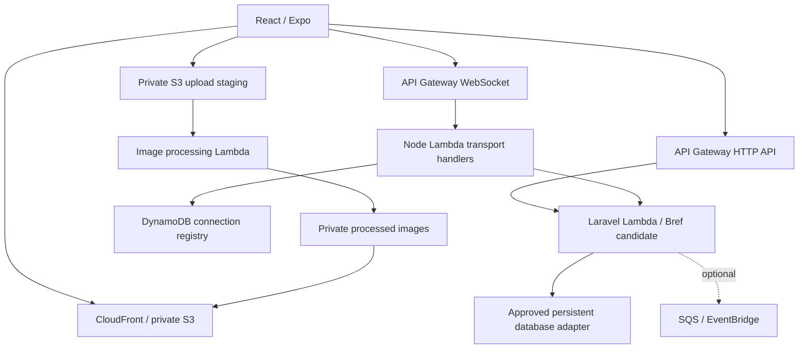

# Battle Arena — AWS Cloud Infrastructure Specification

**Version:** 1.0 | **Date:** 2026-11-26 | **Status:** Proposed, pending repository and account validation

## 1. Objectives and scope
Deploy the existing Battle Arena game to an AWS sandbox for personal use and practical AWS training. Target USD 0 recurring monthly spend, not a guarantee. Preserve local development and existing game rules. The future RPG is out of scope. No commercial launch, paid infrastructure, public PvP activation, or production migration is authorized by this document.

## 2. Existing architecture and constraints
Five sibling repositories: `battle-arena-api` (Laravel), `battle-arena-realtime` (Node.js; GitHub repository battle-arena-realtime-websocket), `battle-arena-web` (React), `battle-arena-mobile` (Expo), `battle-arena-infra` (Docker/Terraform). Last known milestone: Phase 5B.2 implemented and tested locally; current repository status must be verified. Laravel remains the authoritative battle engine; realtime transports notifications. Preserve existing PostgreSQL and Redis local configuration, API contracts, feature flags (`features.pvp=false`), and existing tests. Do not migrate persistence or authentication without explicit approval. Inspect actual repository specifications and dependencies before implementation.

## 3. AWS service catalog
| Service | Purpose | Adoption | Cost exposure |
|---|---|---|---|
| IAM / STS | Least privilege roles, temporary credentials | Foundation | Conventional IAM has no additional charge |
| AWS Budgets / Cost Explorer | Budget and spend review | Foundation | Check budget action and API charges |
| S3 | Private profile images, game assets, optional Terraform state | First deployment | Storage, requests, versions, transfer |
| CloudFront | React SPA and approved image delivery | First deployment | Plan/usage, requests, transfer, optional features |
| Lambda | Image processing; Laravel via Bref feasibility; realtime handlers | Incremental | Requests, duration, memory, logs |
| API Gateway HTTP API | REST ingress | After API feasibility | Requests and transfer |
| API Gateway WebSocket | Connect/disconnect/message routing | After persistence validation | Connection minutes and messages |
| DynamoDB | Connection registry, idempotency and experimental state adapter | Incremental | Capacity, storage, backups, indexes |
| SQS | Optional asynchronous processing | Later lab | Requests, payload size, retries |
| EventBridge | Optional scheduled jobs and domain events | Later lab | Events, schedules, targets |
| SNS | Optional fan-out notifications | Later lab | Publications and deliveries |
| CloudWatch | Logs, metrics and alarms | Foundation | Ingestion, retention, custom metrics |
| Cognito | Optional identity lab, not replacement for existing auth | Later lab | MAUs and optional features |
| Systems Manager Parameter Store | Non-secret configuration and eligible standard secure parameters | As needed | Advanced parameters, throughput, KMS |
| EC2 | Time-boxed Linux/Docker experiments or persistent engine alternative | Optional, approval required | Compute, EBS, IPv4, snapshots |
| RDS / ElastiCache | Future managed PostgreSQL/Redis | Deferred | Recurring charges |
| ECR | Container images only if Lambda packaging requires them | Optional | Storage and transfer |
| Route 53 / ACM | Optional custom DNS and TLS | Deferred | Domains, hosted zones, certificate options |

## 4. Account and financial guardrails
Verify account creation date, plan, remaining credits, expiry, eligible services and regions in Billing before provisioning. New-account credits are temporary; do not assume EC2, S3 or WebSocket are permanently free. Prefer one region, provisionally us-east-1; verify availability, latency and pricing. CloudFront is global. Enable root MFA; no root access keys; use IAM Identity Center or temporary role credentials. Configure actual and forecast budget notifications at USD 1 and 5 where supported, and free-tier usage alerts. Budget notifications are delayed and are not hard spending caps. Restrict deployments to approved services/regions with IAM where practical; use reserved Lambda concurrency, API throttling, authenticated routes, upload quotas and short log retention. Tag all resources Project=BattleArena, Environment=sandbox, Owner, ManagedBy=Terraform. Review costs after each deployment and daily during experiments. Never enable paid resources automatically. If zero spend is mandatory, use local emulators until account coverage is confirmed.

Official references to verify before deployment (not live-verified for this specification):
- https://aws.amazon.com/free/
- https://aws.amazon.com/lambda/pricing/
- https://aws.amazon.com/api-gateway/pricing/
- https://aws.amazon.com/s3/pricing/
- https://aws.amazon.com/cloudfront/pricing/
- https://aws.amazon.com/dynamodb/pricing/
- https://aws.amazon.com/cloudwatch/pricing/
- https://aws.amazon.com/aws-cost-management/aws-budgets/

## 5. Target architecture and decision gates

The diagram is conceptual; database connectivity is unresolved. Do not deploy the full game until persistence is proven. API Gateway WebSocket is managed connection transport, not a persistent Node.js process. Existing socket protocol, room membership, heartbeat and reconnect behavior require compatibility analysis. Lambda memory is not durable or shared. For continuous simulation use a persistent server only after cost approval. For turn-based combat, use transactional authoritative commands and event-driven notifications.

## 6. Persistence and battle integrity
Keep PostgreSQL as the local source of truth. Evaluate: (A) existing PostgreSQL hosted on an explicitly approved low-cost service; (B) a DynamoDB adapter after access-pattern and transactional feasibility analysis; (C) a temporary EC2 sandbox covered by verified credits. Do not silently replace SQL/Eloquent relationships with DynamoDB. RDS is deferred. For DynamoDB experiments, model connectionId, userId, roomId, expiresAt; use appropriate indexes, conditional writes and TTL (asynchronous cleanup, not immediate expiry). Use bounded provisioned capacity where eligible or explicitly cost-model on-demand. Avoid scans and hot partitions. Store battle versions and idempotency keys durably; authorize each command, reject stale versions, persist XP/rewards atomically and prevent duplicate rewards. Use an outbox or equivalent reliable publication strategy; clients resync via authoritative snapshot after reconnect. Redis remains local; evaluate replacing only connection registry/cache use cases, not all Redis semantics.

## 7. Profile pictures and S3
Create globally unique private buckets/prefixes for sandbox user media and game assets. Example keys: `staging/{userId}/{uploadId}`, `profiles/{userId}/{version}/avatar.webp`, `profiles/{userId}/{version}/thumbnail.webp`, `pokemon/`, `arenas/`, `skills/`, `audio/`. Enable Block Public Access, bucket-owner-enforced ownership, default SSE-S3, TLS-only policy, narrowly scoped CORS and IAM. No public ACLs or client AWS credentials.

Upload workflow:
1. Authenticated client requests upload authorization; Laravel verifies ownership, rate limit and quota, creates upload ID and expected key.
2. Issue short-lived presigned POST with content-length-range (maximum 2 MiB) for web where supported; mobile PUT fallback must enforce post-upload validation and cleanup. Never trust MIME or extension alone.
3. Client uploads directly to staging. S3 event invokes image Lambda scoped to staging only.
4. Validate actual image format, dimensions and decoded pixel limits; reject malformed files, SVG and unsupported formats. Strip EXIF, normalize orientation, resize to 256x256 and 64x64 WebP. Use maintained image libraries and bounded processing.
5. Write immutable versioned outputs, record completion idempotently, and update profile metadata only if upload is still current. Never expose unvalidated originals. Handle duplicate/out-of-order S3 events.
6. Serve approved public-facing avatars through CloudFront OAC with private S3 origin; use signed URLs/cookies or authorized short-lived S3 GET for restricted images. OAC alone does not authenticate viewers. Store object keys, not expiring URLs, in database.
7. Expire staging objects after one day; clean obsolete versions after successful replacement and account deletion. Configure lifecycle for noncurrent versions if enabled and incomplete multipart uploads. Avoid recursive Lambda triggers.

Suggested API contracts (adapt to existing conventions): POST /api/profile/avatar/uploads; GET /api/profile/avatar/uploads/{id}; DELETE /api/profile/avatar. Return upload status, key/URL and expiration; enforce ownership. Local storage adapter: MinIO or existing Laravel disk; use test fixtures and integration tests.

## 8. REST and realtime deployment
Audit PHP version, Bref compatibility, extensions, Composer dependencies, filesystem writes, sessions, queues, database connections, cold starts and timeout limits. Package Lambda artifact reproducibly; use /tmp only for ephemeral data; no persistent local sessions. Use existing auth and server-side authorization. Configure CORS, request limits, structured errors and secrets outside code. Evaluate Lambda Function URL only for isolated authenticated lab; prefer HTTP API for the game.

WebSocket routes: $connect, $disconnect, $default and explicit application routes as required. Authenticate connect with short-lived ticket or compatible authorizer; validate membership and identity for every message. Store connection IDs durably; handle stale connections and Gone responses. Use API Gateway Management API with scoped permissions. Preserve event schemas, heartbeat and client reconnect/resync; verify service idle timeout, maximum connection duration, message/frame limits and regional quotas before deployment. Do not use Lambda for an always-running socket loop. Test duplicate commands, disconnects, concurrent turns and server restarts.

## 9. Infrastructure as code and CI/CD
Proposed layout (adapt existing infra structure):
```
battle-arena-infra/
  terraform/
    modules/{iam,budgets,s3,cloudfront,lambda,http-api,websocket,dynamodb,observability}/
    environments/sandbox/
  docs/BATTLE_ARENA_AWS_INFRASTRUCTURE_SPEC_EN.md
  scripts/
```
Pin Terraform/provider versions; commit lockfile; never commit state, secrets or tfvars containing credentials. Start with protected local state or approved encrypted remote S3 state with locking supported by selected Terraform version. Bootstrap state separately; account for storage/version costs. Use GitHub Actions OIDC with repository/branch/environment-restricted trust, separate plan/apply roles, manual approval for apply and destroy. Run fmt, validate, security checks, tests and plan on PR. No automatic apply on pull requests. Publish web assets with immutable caching for hashed files and short cache for index.html; configure SPA routing without exposing private media. Roll back via prior deployment artifact and configuration; retain only necessary versions.

## 10. Observability, security and operations
Structured logs with correlationId, battleId and requestId; redact tokens, signed URLs and personal data. Set short sandbox retention (7 days initially); avoid high-volume debug logs and unnecessary custom metrics. Track API errors, Lambda throttles/duration, failed image processing, stale sockets, rejected battle commands and costs. Use least privilege per function, dependency scanning, encrypted transport, secrets rotation, and input validation. Avoid NAT Gateway, paid VPC endpoints, dedicated load balancers and always-on databases unless approved. Establish backup/export and restore tests for persistent data; document deletion and recovery. Sandbox is invite-only, not high availability; downtime and interrupted matches are acceptable only with safe recovery/cancellation.

## 11. Cost model and controls
Estimate monthly usage before apply: Lambda requests + GB-seconds; HTTP requests; WebSocket connection minutes + message units; DynamoDB capacity + storage; S3 GB-month + PUT/GET + transfer; CloudFront requests/transfer; CloudWatch ingestion/retention; optional KMS/ECR/EC2. Subtract only verified eligible allowances/credits. Example: 20 testers x 30 minutes/day x 30 days = 18,000 connection minutes; 100 messages per tester/day = 60,000 messages/month before fan-out and size rounding. 100 profiles x 100 KB = approximately 10 MB stored, excluding staging and versions. These are workload assumptions, not price quotes. Set upload limits, session expiry, API throttles and Lambda concurrency; these reduce but do not eliminate financial risk. Stop experiments and review billing if charges appear. Keep a cost ledger per phase.

## 12. Implementation roadmap and acceptance gates
| Phase | Deliverable | Acceptance |
|---|---|---|
| AWS-01 | Account, IAM, budgets, inventory | Eligibility verified, MFA and alerts configured, no unapproved spend |
| AWS-02 | Terraform foundation | Reproducible plan, scoped roles, protected state, manual approval |
| AWS-03 | S3 profile media | Private buckets, validated upload, WebP outputs, deletion and access tests |
| AWS-04 | CloudFront web and media | HTTPS, SPA routing, OAC, cache and privacy tests |
| AWS-05 | Laravel Lambda proof of concept | Existing API/auth tests pass; persistence decision documented |
| AWS-06 | Persistence adapter | Integrity, migrations, concurrency, recovery and cost reviewed |
| AWS-07 | WebSocket transport | Two-client smoke test, reconnect, authorization, stale connection cleanup |
| AWS-08 | SQS/EventBridge/SNS labs | Idempotent jobs, bounded retries, DLQ where applicable, cost review |
| AWS-09 | CI/CD and monitoring | OIDC, manual deployment, rollback, logs and alerts tested |
| AWS-10 | Sandbox validation | End-to-end PvE/PvP private tests, cost audit, teardown rehearsal |

## 13. Testing matrix
Unit: image validation, ownership, command idempotency, adapters. Integration: S3 upload/event processing, DynamoDB conditional writes, API auth, database transactions. E2E: web/mobile avatar upload and deletion, two-player battle, reconnect and snapshot, duplicate rewards prevention. Security: cross-user access, oversized/malformed uploads, unauthorized socket commands, credential exposure. Load: bounded k6 tests only after approval; measure latency, cold starts, message fan-out and costs. Regression: existing local Docker smoke tests and feature flags. Teardown: terraform plan -destroy, explicit approval, preserve required data, empty versioned buckets only when authorized, verify remaining resources and delayed billing.

## 14. Cursor implementation instructions
Start with read-only audit of all five repositories and existing phase specs. Report actual stack, git status, dependencies, current storage/auth/database/realtime contracts, conflicts with this proposal and account prerequisites. Implement AWS-01 and AWS-02 only after approval; produce a separate plan for AWS-03 profile images. Do not provision resources, run terraform apply/destroy, push commits, modify existing battle rules, migrate data, or enable public PvP without explicit authorization. Keep documentation and code comments in English. For each phase provide changed files, tests and results, cost estimate, security implications, rollback steps and unresolved issues. Never claim cloud tests passed unless executed. Preserve local development throughout.

## 15. Open decisions
Account eligibility and credits; exact AWS region; current repo state; PostgreSQL hosting or approved adapter; existing WebSocket protocol compatibility; avatar visibility policy; whether existing game assets can legally be hosted; exact runtime and deployment packaging. Commercial use of Pokémon-related names/assets requires separate intellectual-property review. No AWS account or repository was inspected and no resources were deployed while drafting this document.
