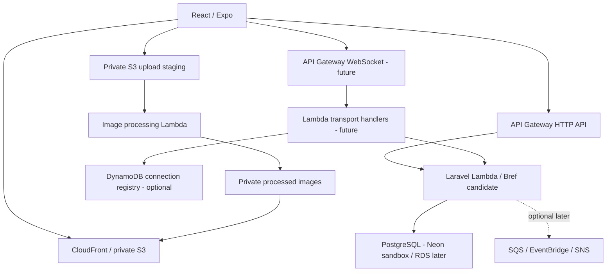

# Battle Arena — AWS Cloud Infrastructure Specification

**Version:** 1.1 | **Date:** 2026-11-26 | **Status:** Proposed, pending repository and account validation  
**Scope:** Documentation of the Battle Arena cloud strategy only. This revision does not authorize provisioning, deployment, or application changes.

## 1. Objectives and scope

Deploy Battle Arena to a personal AWS sandbox for practical AWS training while targeting a monthly infrastructure cost of **USD 0.00**. That figure is a **budget target**, not a guarantee.

This document:

- Clarifies the near-zero-cost AWS deployment strategy.
- Preserves the current local Docker Compose development environment.
- Keeps PostgreSQL as the primary relational database.
- Treats DynamoDB, managed Redis replacements, and API Gateway WebSocket as **optional future** evaluations—not current requirements.
- Restricts paid infrastructure unless the owner explicitly approves a documented cost assessment.

Out of scope for this specification: commercial launch, public PvP activation (`features.pvp` remains governed by product policy), full production migration, and the future RPG product line.

## 2. Architectural principles

| Principle | Meaning for Battle Arena |
|---|---|
| **AWS First** | AWS is the primary cloud provider for sandbox and future commercial deployment. External free-tier services (for example Neon) are allowed only when they reduce cost without abandoning AWS as the core platform. |
| **Zero-Cost First** | Prefer recurring free-tier allowances, serverless/on-demand services, scale-to-zero where supported, minimal storage/network use, and automatic cleanup of temporary resources. |
| **Local Development First** | Day-to-day development and automated tests run fully on Docker Compose without AWS connectivity, credentials, or external cloud dependencies. |
| **Infrastructure as Code** | Cloud resources are defined in Terraform under `battle-arena-infra`, reviewed before apply, and never hand-configured as the source of truth. |
| **Security by Design** | Least privilege IAM, private storage, encrypted transport, no public buckets, secrets outside source control, and authenticated API/realtime paths. |
| **Incremental Cloud Adoption** | Introduce AWS services only when a concrete Battle Arena requirement justifies them—not to inflate the technology inventory. |
| **Backward Compatibility** | Local Compose services, API contracts, Eloquent models, battle rules, and existing tests remain valid as cloud adapters are added. |
| **Provider Abstraction Where Justified** | Prefer environment-specific configuration (filesystem disks, DB URLs, WS endpoints) over provider-specific business logic. |
| **Commercial Readiness Without Premature Complexity** | Design so production (RDS/Aurora, CloudFront, hardened IAM) is reachable later, without provisioning expensive components during the personal sandbox phase. |

## 3. Existing architecture and local infrastructure

### 3.1 Repositories

Five sibling repositories:

| Repository | Role |
|---|---|
| `battle-arena-api` | Laravel authoritative API and battle engine |
| `battle-arena-realtime` | Node.js WebSocket transport (GitHub: battle-arena-realtime-websocket) |
| `battle-arena-web` | React web client |
| `battle-arena-mobile` | Expo mobile client |
| `battle-arena-infra` | Docker Compose local stack and Terraform |

Last known gameplay milestone context: Phase 5B.x PvP work implemented and tested locally; **current repository status must be verified** before cloud implementation. Laravel remains the authoritative battle engine; the realtime service transports notifications and presence—it does not own battle rules, progression, or results.

### 3.2 Preserve the existing local Docker Compose environment

The current Docker Compose environment **must remain unchanged** for this strategy. Preserve all existing services:

| Local service | Role |
|---|---|
| Laravel API | Authoritative HTTP API, auth, combat, progression |
| React Web | Local web client |
| Node.js Realtime Server | Local WebSocket transport and presence coordination |
| PostgreSQL | Primary relational database |
| Redis | Realtime coordination and temporary state as currently implemented |
| MinIO | Local S3-compatible object storage |
| MinIO initialization service | Bucket/bootstrap for local storage |
| Mailpit | Local email capture |

**Do not** (at this documentation stage or during early sandbox phases unless separately approved):

- Introduce new Compose containers.
- Replace existing local services.
- Require AWS connectivity, AWS credentials, or external cloud dependencies for local development.

Local development must remain fully functional offline from AWS.

### 3.3 Application constraints to preserve

Preserve:

- Existing Laravel Eloquent models, migrations, relationships, constraints, and transactions.
- Pokémon catalog and evolution data.
- Player progression, XP, and levels.
- Battle records and results.
- Existing automated tests.
- API contracts and feature flags (including `features.pvp=false` until product policy changes).
- Existing Redis integrations used by the API and realtime server.
- MinIO + Laravel filesystem integration for local object storage.

Do not migrate persistence or authentication stacks without explicit owner approval.

## 4. PostgreSQL strategy

PostgreSQL remains the **primary relational database** and the **authoritative persistent data store** for Battle Arena.

### 4.1 What PostgreSQL owns

- Catalog data (creatures, moves, types, learnsets, evolutions).
- Player accounts, profiles, progression, XP, and levels.
- Collection and inventory state as modeled today.
- Battle records, results, rewards, and related transactional integrity.
- PvP room/battle persistence as implemented in Laravel.

### 4.2 Deployment options by environment

| Environment | Database |
|---|---|
| Local development | Existing Docker PostgreSQL |
| Personal cloud sandbox | Neon PostgreSQL Free Plan, **subject to validation** |
| AWS learning experiments | Amazon RDS or Aurora PostgreSQL |
| Future commercial production | Amazon RDS or Aurora PostgreSQL |

Neon is an acceptable **external dependency for the personal sandbox** if its free-tier limits accommodate the existing database size, connection patterns, and workload. AWS remains the primary cloud infrastructure provider; Neon does not replace the long-term intent to run managed PostgreSQL on AWS for commercial production.

### 4.3 Explicit non-goals

- **Do not** propose a full migration from PostgreSQL to DynamoDB.
- **Do not** treat DynamoDB as a substitute for Eloquent relationships, SQL transactions, or catalog persistence.
- Amazon RDS / Aurora remain **deferred paid infrastructure** for the personal sandbox unless the owner approves a cost assessment.

### 4.4 Pre-selection evaluation criteria

Before selecting any cloud database option, evaluate:

- Storage requirements (schema size, media metadata, growth).
- Connection pooling and concurrent connection limits (especially serverless/Lambda).
- PostgreSQL compatibility (extensions, versions, SQL features used by Laravel).
- Latency from the chosen compute region.
- Security (TLS, network exposure, credentials, IAM where applicable).
- Backups, point-in-time recovery, and restore drills.
- Estimated monthly cost versus free-tier / Neon limits.

## 5. Redis strategy

### 5.1 Current posture

Preserve the existing Redis container and **all current Redis integrations**.

Redis remains responsible for its currently implemented functionality, including realtime coordination and temporary state where the API and Node.js realtime server already use it (for example presence keys, tickets, or pub/sub hints—exact keys and flows must be confirmed by audit).

### 5.2 Replacement policy

Before proposing any Redis replacement:

1. Conduct a technical audit of Redis usage across the Laravel API and the Node.js Realtime Server.
2. Classify each use case (ephemeral ticket, presence set, pub/sub fan-out, cache, lock, etc.).
3. Map only justified use cases to AWS alternatives.

Possible **future** AWS alternatives (not initial sandbox defaults):

| Alternative | Candidate use |
|---|---|
| DynamoDB | Temporary records and connection registries |
| API Gateway WebSocket | Managed connection lifecycle |
| EventBridge | Asynchronous domain/scheduled events |
| SQS | Background processing |
| ElastiCache or Valkey | Workloads that genuinely require Redis-compatible semantics |

Any replacement must preserve existing functionality, security, consistency, and performance.

### 5.3 Sandbox restriction

**Do not** introduce Amazon ElastiCache (or equivalent paid Redis-compatible managed cache) during the initial personal sandbox deployment.

## 6. DynamoDB strategy

### 6.1 Role

DynamoDB is an **optional future infrastructure component**. It is **not required** by the current Battle Arena implementation.

Potential future use cases include:

- WebSocket connection registry.
- Temporary authentication tickets.
- Player presence.
- Room membership lookup.
- Matchmaking queues.
- Idempotency records.
- Temporary distributed state.

### 6.2 Hard boundaries

- DynamoDB **must not** replace PostgreSQL as the primary database.
- DynamoDB **must not** be treated as a direct replacement for Redis Pub/Sub.
- DynamoDB TTL deletion is **asynchronous** and **must not** be relied upon for immediate expiration enforcement. Application logic must enforce expiry independently when correctness depends on it.

### 6.3 DynamoDB Local

DynamoDB Local must be introduced **only when a concrete feature requires DynamoDB integration**.

At that stage, evaluate adding:

- Official Amazon DynamoDB Local Docker image.
- Optional DynamoDB Admin interface.
- Persistent local storage volume.
- Environment-specific AWS SDK configuration.
- Automated integration tests.

**Do not** add these containers now. Local Compose remains unchanged until a justified DynamoDB feature is approved.

## 7. MinIO and Amazon S3 strategy

### 7.1 Environment mapping

MinIO remains the official **local** S3-compatible object storage implementation. Preserve the existing MinIO container, initialization service, buckets, and Laravel filesystem integration.

| Environment | Object storage |
|---|---|
| Local development | MinIO |
| AWS sandbox | Amazon S3 |
| Future production | Amazon S3 with CloudFront where appropriate |

The application should use **environment-specific configuration** (disk/driver settings, bucket names, endpoints, credentials) rather than provider-specific business logic.

### 7.2 Intended S3 content classes

Amazon S3 will be used for:

- Player profile pictures.
- Player avatars.
- Pokémon images, subject to applicable usage rights.
- Arena backgrounds.
- Game assets.
- Audio assets.
- Temporary uploads.
- Approved backup exports.

### 7.3 Security and optimization requirements

Documented requirements for AWS object storage:

- Private S3 buckets.
- S3 Block Public Access.
- IAM least-privilege policies.
- Presigned upload URLs (short-lived).
- File size restrictions.
- Content validation (do not trust client MIME/extension alone).
- Image optimization.
- EXIF metadata removal.
- Lifecycle rules for temporary / staging files.
- CloudFront Origin Access Control (OAC) where public-facing delivery is required.

Direct uploads must include appropriate size and content restrictions, ownership verification, and post-upload validation.

### 7.4 Profile media upload workflow (sandbox design)

Create globally unique private buckets/prefixes for sandbox user media and game assets. Example keys: `staging/{userId}/{uploadId}`, `profiles/{userId}/{version}/avatar.webp`, `profiles/{userId}/{version}/thumbnail.webp`, `pokemon/`, `arenas/`, `skills/`, `audio/`. Enable Block Public Access, bucket-owner-enforced ownership, default SSE-S3, TLS-only bucket policy, narrowly scoped CORS and IAM. No public ACLs or client-embedded long-lived AWS credentials.

Upload workflow:

1. Authenticated client requests upload authorization; Laravel verifies ownership, rate limit and quota, creates upload ID and expected key.
2. Issue short-lived presigned POST with content-length-range (maximum 2 MiB) for web where supported; mobile PUT fallback must enforce post-upload validation and cleanup.
3. Client uploads directly to staging. An S3 event may invoke an image-processing Lambda scoped to staging only.
4. Validate actual image format, dimensions and decoded pixel limits; reject malformed files, SVG and unsupported formats. Strip EXIF, normalize orientation, resize to 256×256 and 64×64 WebP. Use maintained image libraries and bounded processing.
5. Write immutable versioned outputs, record completion idempotently, and update profile metadata only if the upload is still current. Never expose unvalidated originals. Handle duplicate/out-of-order S3 events.
6. Serve approved public-facing avatars through CloudFront OAC with private S3 origin; use signed URLs/cookies or authorized short-lived S3 GET for restricted images. OAC alone does not authenticate viewers. Store object keys, not expiring URLs, in the database.
7. Expire staging objects after one day; clean obsolete versions after successful replacement and account deletion. Configure lifecycle for noncurrent versions (if versioning is enabled) and incomplete multipart uploads. Avoid recursive Lambda triggers.

Suggested API contracts (adapt to existing conventions): `POST /api/profile/avatar/uploads`; `GET /api/profile/avatar/uploads/{id}`; `DELETE /api/profile/avatar`. Local storage adapter remains MinIO / existing Laravel disk with fixtures and integration tests.

**Do not** change the current MinIO implementation as part of this documentation task.

## 8. Realtime architecture

### 8.1 Local (authoritative for development)

Preserve the existing Node.js WebSocket server for local development.

- Laravel remains the authoritative source for battle rules, battle state transitions, player progression, and battle results.
- The realtime service remains a **communication transport layer** (notifications, presence, room hints)—not the rules engine.

### 8.2 AWS evaluation (future phases)

For AWS, evaluate (do not assume a drop-in):

- Amazon API Gateway WebSocket API.
- AWS Lambda.
- DynamoDB connection registry.
- AWS SDK API Gateway Management API.
- Connection lifecycle management.
- Authentication and authorization (including short-lived tickets).
- Reconnection and authoritative state synchronization.
- Message delivery and failure handling (including Gone / stale connection IDs).

**Do not** assume that the existing persistent Node.js WebSocket server can be deployed directly to Lambda without architectural adaptations. Lambda memory is not durable or shared; an always-running socket loop is not a valid Lambda pattern.

Do not modify the existing realtime implementation under this documentation revision. Cloud-specific adapters must preserve local realtime compatibility when eventually implemented.

## 9. AWS service classification

### 9.1 Initial foundation

| Service | Purpose |
|---|---|
| AWS IAM | Least-privilege identities and policies |
| AWS STS | Temporary credentials |
| AWS Budgets | Spend and forecast alerts |
| AWS Cost Explorer | Spend analysis |
| Terraform | Infrastructure as code |

### 9.2 Initial deployment

| Service | Purpose |
|---|---|
| Amazon S3 | Private media, assets, optional Terraform state |
| Amazon CloudFront | React SPA and approved asset delivery |
| Amazon CloudWatch | Logs, metrics, alarms |

### 9.3 Application deployment — subject to technical evaluation

| Service / option | Purpose |
|---|---|
| AWS Lambda | Candidate compute for API / image processing |
| Bref for PHP/Laravel | Candidate Laravel-on-Lambda packaging |
| Amazon API Gateway HTTP API | REST ingress |
| External Neon PostgreSQL | Personal sandbox database candidate (free-plan validation required) |

### 9.4 Future realtime integration

| Service | Purpose |
|---|---|
| Amazon API Gateway WebSocket API | Managed WebSocket transport |
| Amazon DynamoDB | Connection registry and temporary distributed state |
| DynamoDB Local | Local DynamoDB emulation when a feature requires it |
| AWS Lambda | WebSocket route handlers |

### 9.5 Future or optional integrations

Amazon SQS, Amazon SNS, Amazon EventBridge, Amazon SES, Amazon Cognito (lab only; not an automatic replacement for existing auth), AWS Systems Manager Parameter Store, AWS Secrets Manager, Amazon EC2 (time-boxed experiments only), Amazon ECR.

### 9.6 Deferred paid infrastructure

The following must **not** be provisioned without **explicit owner approval** and a **documented cost assessment**:

- Amazon RDS
- Amazon Aurora
- Amazon ElastiCache
- Amazon EKS
- NAT Gateway
- Dedicated load balancers
- Amazon Route 53 (custom domains / hosted zones as cost-bearing choices)

Conventional IAM has no additional charge for typical identity management. Always verify current pricing for Budgets actions, API calls, storage, transfer, and optional features before apply.

## 10. Zero-cost-first policy

### 10.1 Target

The personal Battle Arena sandbox must target a monthly infrastructure cost of **USD 0.00**.

### 10.2 Priorities

- Recurring free-tier allowances.
- Serverless and on-demand services.
- Scale-to-zero capabilities where supported.
- Minimal storage and network consumption.
- Local development and testing as the default workflow.
- Controlled / invite-only access during the sandbox phase.
- Automatic cleanup of temporary resources (staging objects, short log retention, tear-down rehearsals).

### 10.3 Cost terminology (must not be confused)

| Category | Meaning |
|---|---|
| **Recurring free-tier allowances** | Ongoing monthly/annual free usage that may renew while the account remains eligible |
| **Promotional AWS credits** | Temporary account credits that expire; not permanent free usage |
| **Time-limited free-tier offers** | New-account or campaign offers that end after a fixed period |
| **Billable resources** | Any usage beyond eligible free allowances/credits |

AWS Free Tier eligibility, regional pricing, account-specific credits, and service limits **must be verified** in Billing Console before provisioning. Do not assume EC2, S3, WebSocket connection minutes, or CloudFront are permanently free.

### 10.4 Budget alerts

Configure proposed AWS Budgets alerts at:

- **USD 1**
- **USD 5**
- **USD 10**

**AWS Budgets alerts are not guaranteed hard spending limits.** Notifications can be delayed. They reduce risk but do not eliminate unexpected charges. Prefer IAM region/service restrictions, Lambda reserved concurrency caps, API throttling, authenticated routes, upload quotas, and short log retention as complementary controls.

### 10.5 Tagging and review

Tag all resources: `Project=BattleArena`, `Environment=sandbox`, `Owner`, `ManagedBy=Terraform`. Review costs after each deployment and daily during active experiments. Never enable paid resources automatically. If zero spend is mandatory until eligibility is confirmed, stay on local emulators.

Official references to verify before deployment (not live-verified for this specification):

- https://aws.amazon.com/free/
- https://aws.amazon.com/lambda/pricing/
- https://aws.amazon.com/api-gateway/pricing/
- https://aws.amazon.com/s3/pricing/
- https://aws.amazon.com/cloudfront/pricing/
- https://aws.amazon.com/dynamodb/pricing/
- https://aws.amazon.com/cloudwatch/pricing/
- https://aws.amazon.com/aws-cost-management/aws-budgets/

## 11. Target architecture and decision gates



The diagram is conceptual. Database connectivity for Lambda and WebSocket transport design are **decision gates**, not committed designs.

Decision gates before full-game cloud deployment:

1. Account Free Tier / credit eligibility verified.
2. PostgreSQL hosting choice validated (Neon free plan vs deferred RDS/Aurora).
3. Laravel-on-Lambda / Bref feasibility proven against existing tests.
4. Redis usage audited before any replacement proposal.
5. WebSocket protocol compatibility analyzed before API Gateway WebSocket adoption.
6. Owner approval obtained before any deferred paid service.

Prefer one region provisionally (`us-east-1`); verify availability, latency, and pricing. CloudFront remains global. Enable root MFA; no root access keys; use IAM Identity Center or temporary role credentials.

## 12. REST and realtime deployment notes

### 12.1 Laravel / HTTP API

Audit PHP version, Bref compatibility, extensions, Composer dependencies, filesystem writes, sessions, queues, database connections, cold starts, and timeout limits. Package Lambda artifacts reproducibly; use `/tmp` only for ephemeral data; no persistent local sessions on Lambda. Keep existing auth and server-side authorization. Configure CORS, request limits, structured errors, and secrets outside code. Prefer API Gateway HTTP API for the game; evaluate Function URLs only for isolated authenticated labs.

### 12.2 WebSocket (when approved)

Routes typically include `$connect`, `$disconnect`, `$default`, and explicit application routes. Authenticate connect with a short-lived ticket or compatible authorizer; validate membership and identity for every message. Store connection IDs durably if using a managed WS API; handle stale connections and Gone responses. Use the API Gateway Management API with scoped permissions. Preserve event schemas, heartbeat, and client reconnect/resync against authoritative Laravel snapshots. Verify idle timeout, maximum connection duration, message/frame limits, and regional quotas before deployment.

## 13. Infrastructure as code and CI/CD

Proposed layout (adapt existing infra structure):

```
battle-arena-infra/
  terraform/
    modules/{iam,budgets,s3,cloudfront,lambda,http-api,websocket,dynamodb,observability}/
    environments/sandbox/
  docs/BATTLE_ARENA_AWS_INFRASTRUCTURE_SPEC_EN.md
  scripts/
```

Pin Terraform/provider versions; commit the lockfile; never commit state, secrets, or tfvars containing credentials. Start with protected local state or approved encrypted remote S3 state with locking supported by the selected Terraform version. Bootstrap state separately; account for storage/version costs.

Use GitHub Actions OIDC with repository/branch/environment-restricted trust, separate plan/apply roles, and **manual approval** for apply and destroy. Run fmt, validate, security checks, tests, and plan on pull requests. **No automatic apply on pull requests.**

Publish web assets with immutable caching for hashed files and short cache for `index.html`; configure SPA routing without exposing private media. Roll back via prior deployment artifact and configuration; retain only necessary versions.

## 14. Observability, security, and operations

Structured logs with `correlationId`, `battleId`, and `requestId`; redact tokens, signed URLs, and personal data. Set short sandbox retention (7 days initially); avoid high-volume debug logs and unnecessary custom metrics. Track API errors, Lambda throttles/duration, failed image processing, stale sockets, rejected battle commands, and costs.

Use least privilege per function, dependency scanning, encrypted transport, secrets rotation, and input validation. Avoid NAT Gateway, paid VPC endpoints, dedicated load balancers, and always-on databases unless approved.

Establish backup/export and restore tests for persistent PostgreSQL data; document deletion and recovery. The sandbox is invite-only, not high availability; downtime and interrupted matches are acceptable only with safe recovery/cancellation semantics.

## 15. Cost model and controls

Estimate monthly usage before apply:

- Lambda requests + GB-seconds
- HTTP API requests
- WebSocket connection minutes + message units (when used)
- DynamoDB capacity + storage (when used)
- S3 GB-month + PUT/GET + transfer
- CloudFront requests/transfer
- CloudWatch ingestion/retention
- Optional KMS / ECR / EC2

Subtract **only verified** eligible allowances/credits.

Workload examples (assumptions, not price quotes):

- 20 testers × 30 minutes/day × 30 days = 18,000 connection minutes
- 100 messages per tester/day = 60,000 messages/month before fan-out and size rounding
- 100 profiles × 100 KB ≈ 10 MB stored, excluding staging and versions

Set upload limits, session expiry, API throttles, and Lambda concurrency. These reduce but do not eliminate financial risk. Stop experiments and review billing if charges appear. Keep a cost ledger per phase.

## 16. Implementation roadmap

| Phase | Name | Deliverables | Acceptance |
|---|---|---|---|
| **AWS Phase 01** | Foundation | AWS account assessment; Free Tier and credit verification; IAM and security; billing and budgets (USD 1 / 5 / 10); Terraform foundation | Eligibility verified; MFA and alerts configured; no unapproved spend |
| **AWS Phase 02** | Object storage | Amazon S3; MinIO compatibility assessment; profile pictures/avatars; game assets; storage security (Block Public Access, IAM, lifecycle) | Private buckets; validated upload path design; no public ACL exposure |
| **AWS Phase 03** | Frontend hosting | React production build; S3 + CloudFront; HTTPS and cache configuration | HTTPS SPA works; OAC/private origin where required; cache policy validated |
| **AWS Phase 04** | Database assessment | PostgreSQL storage/workload analysis; Neon Free Plan evaluation; RDS/Aurora cost comparison; connectivity and security review | Written decision: Neon vs defer RDS/Aurora; pooling/security documented |
| **AWS Phase 05** | Laravel deployment | Lambda + Bref feasibility; API Gateway HTTP API; environment configuration; PostgreSQL connectivity; application integration tests | Existing API/auth tests pass against chosen persistence; packaging documented |
| **AWS Phase 06** | Realtime assessment | Audit Redis and WebSocket usage; evaluate API Gateway WebSocket; define connection/ticket persistence needs; introduce DynamoDB Local **only if justified** | Audit report; go/no-go for managed WS; Compose unchanged unless DynamoDB Local approved |
| **AWS Phase 07** | Realtime deployment | Cloud-specific adapters; preserve local realtime compatibility; validate auth, reconnection, battle synchronization | Two-client smoke; reconnect/resync; authorization and stale-connection handling |
| **AWS Phase 08** | Additional AWS services | SQS, SNS, EventBridge, SES, others **only when justified by concrete requirements** | Idempotent jobs; bounded retries; DLQ where applicable; cost review |
| **AWS Phase 09** | CI/CD and monitoring | GitHub Actions; AWS OIDC; CloudWatch; Terraform validation; security and cost monitoring | Manual apply gate; rollback path; logs/alerts tested |
| **AWS Phase 10** | Release readiness | Integration, performance, and security validation; cost verification; rollback and disaster recovery procedures | End-to-end sandbox validation; teardown rehearsal; cost audit signed off |

## 17. Testing matrix

| Layer | Focus |
|---|---|
| Unit | Image validation, ownership, command idempotency, adapters |
| Integration | S3 upload/event processing, DynamoDB conditional writes (when introduced), API auth, PostgreSQL transactions |
| E2E | Web/mobile avatar upload and deletion; two-player battle; reconnect and authoritative snapshot; duplicate rewards prevention |
| Security | Cross-user access; oversized/malformed uploads; unauthorized socket commands; credential exposure |
| Load | Bounded k6 tests only after approval; measure latency, cold starts, message fan-out, and costs |
| Regression | Existing local Docker smoke tests and feature flags |
| Teardown | `terraform plan -destroy`, explicit approval, preserve required data, empty versioned buckets only when authorized, verify remaining resources and delayed billing |

## 18. Cursor / agent implementation instructions

Start with a read-only audit of all five repositories and existing phase specs. Report actual stack, git status, dependencies, current storage/auth/database/realtime contracts, conflicts with this proposal, and account prerequisites.

Implement **AWS Phase 01** (and Terraform foundation) only after owner approval; produce a separate plan for Phase 02 object storage / profile images.

**Hard restrictions unless the owner explicitly authorizes otherwise:**

- Do not provision AWS resources.
- Do not run `terraform apply` / `terraform destroy`.
- Do not push commits.
- Do not modify Docker Compose, add/remove containers, or replace PostgreSQL / Redis / MinIO.
- Do not modify application source code, migrations, battle engine rules, or PvP feature flags under a documentation-only task.
- Do not install dependencies solely for cloud experiments without approval.
- Do not modify credentials.

Keep documentation and code comments in English. For each implementation phase provide: changed files, tests and results, cost estimate, security implications, rollback steps, and unresolved issues. Never claim cloud tests passed unless executed. Preserve local development throughout.

## 19. Open / outstanding technical decisions

| Decision | Notes |
|---|---|
| Account eligibility and credits | Free Tier status, promotional credits, expiry dates |
| Exact AWS region | Provisional `us-east-1`; confirm latency and pricing |
| Current repository milestone state | Verify against claimed Phase 5B.x completion |
| Personal sandbox PostgreSQL host | Neon Free Plan vs remaining local-only until RDS/Aurora is justified |
| Laravel-on-Lambda / Bref feasibility | PHP version, extensions, cold start, DB pooling |
| Redis usage inventory | Required before any cloud replacement proposal |
| WebSocket protocol compatibility | Existing Node protocol vs API Gateway WebSocket adaptations |
| Avatar visibility policy | Public via CloudFront vs signed/restricted delivery |
| Legal rights for game assets | Including Pokémon-related names/images |
| Exact runtime packaging | Artifact layout, CI, secrets strategy |

Commercial use of Pokémon-related names/assets requires a separate intellectual-property review.

## 19a. Local environment with production parity (v1.3, 2026-11-27)

**This supersedes §3.2 and §6.3 for local development.** The owner decided that the single local Docker Compose environment is itself production-shaped; there is no separate legacy development stack and no parallel simulation. `docker compose up -d --build` runs Laravel on the official Bref v3 Lambda image (`api` HTTP function, `console` artisan function), the realtime transport as a Node.js 22 Lambda (`realtime`) behind a local API Gateway WebSocket emulator, a local API Gateway HTTP API emulator with an EventBridge-style schedule (`gateway`), the React production build behind Nginx (`web`), and the existing PostgreSQL, Redis, RustFS and Mailpit services with their existing data. Ports (3000 / 8000 / 3001) and client contracts are unchanged; the mobile app is untouched. The old `php artisan serve`, Vite and persistent Node WebSocket containers were removed from Compose; their volumes were kept. Details, daily workflow and remaining differences: `README.md`. Migration state and next steps: `docs/AWS_MIGRATION_CHECKPOINT.md`.

Decision-gate status from this environment (local evidence only; nothing was provisioned):

| Gate | Status |
|---|---|
| 3. Laravel-on-Lambda / Bref feasibility | **Feasible locally** with Bref v3 + `bref/laravel-bridge` 3.1 (2.x does not support Laravel 13). Full e2e passes through the HTTP API emulator. S3 session token, Swagger docs path and `telescope:prune` schedule fixed in the API; `bref/*` packages still to be added to `composer.json`. |
| 4. Redis usage audit | Uses confirmed: tickets/grants (`GETDEL`), presence set/hash, sessions, cache, rate limits, schedule locks, Pub/Sub hints (dev transport only). Upstash single-DB constraint requires `REDIS_CACHE_DB=0` and no `cache:clear`. |
| 5. WebSocket protocol compatibility | **Compatible without client changes** (web and Expo untouched): Lambda adapter keeps the v1 frames, ticket/grant contracts and presence keys; registry in Redis; `connection.ready` via async self-invoke; Laravel publishes via async Lambda invoke (`PVP_REALTIME_DRIVER=lambda`). |
| SQS / DynamoDB | Not justified yet (no gameplay jobs; registry fits Redis). |

Neon, Upstash, IAM, CloudFront and real API Gateway behaviour remain unvalidated; see README "Remaining differences from real AWS".

## 20. Document history and execution confirmation (this revision)

**Version 1.1** updates Version 1.0 to:

- Emphasize Local Development First and an unchanged Docker Compose inventory.
- Make PostgreSQL the unambiguous primary datastore, with Neon as a sandbox candidate and RDS/Aurora deferred for production/learning experiments.
- Reclassify DynamoDB as optional future infrastructure (not a PostgreSQL replacement; not a Redis Pub/Sub replacement).
- Preserve Redis and MinIO locally; defer ElastiCache; map S3 for AWS.
- Reorder the roadmap into Phases 01–10 (foundation → storage → frontend → DB assessment → Laravel → realtime assessment/deployment → additional services → CI/CD → readiness).
- Strengthen Zero-Cost First policy, including USD 1 / 5 / 10 budget alerts and free-tier terminology distinctions.
- Add explicit architectural principles and service classification tiers.

**While preparing this documentation revision:**

- No application source code was modified.
- No Docker Compose or infrastructure configuration was modified.
- No AWS resources were provisioned.
- No Terraform apply/destroy was executed.
- No commit or push was performed.
