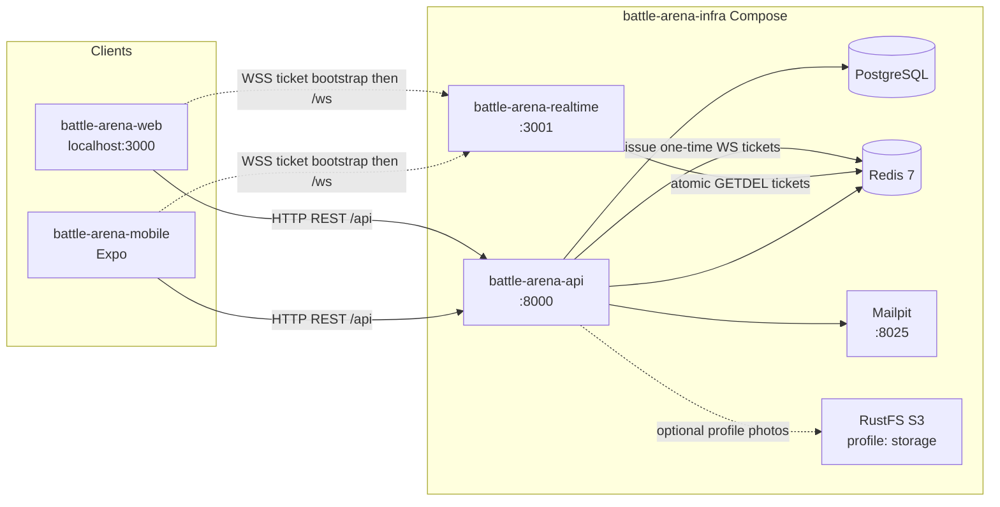

# Battle Arena Infrastructure

Central Docker Compose development environment for sibling repositories.

This repo **only orchestrates** local containers. Application source lives in the sibling folders next to `battle-arena-infra`.

## Expected folder layout

Clone all repositories as **siblings** under the same parent directory (example on Windows):

```text
C:\FREELANCE\games\
├── battle-arena-api\                 # Laravel REST API
├── battle-arena-web\                 # React + Vite web client
├── battle-arena-mobile\              # Expo mobile client (runs outside Docker)
├── battle-arena-realtime\            # Node.js WebSocket gateway
└── battle-arena-infra\               # This repo — Compose only
    ├── compose.yaml
    ├── .env.example
    └── README.md
```

`compose.yaml` builds from `../battle-arena-api`, `../battle-arena-web`, and `../battle-arena-realtime`. If those folders are missing or named differently, `docker compose up --build` will fail.

## Repository responsibilities

| Repository | Role | Runs in Compose? |
|------------|------|------------------|
| `battle-arena-api` | Laravel 13 REST API — auth, game rules, PvE, private PvP lobbies, persistence | Yes (`api`) |
| `battle-arena-web` | React + Vite + Tailwind web client | Yes (`web`) |
| `battle-arena-mobile` | Expo / React Native client | No (host machine / Expo) |
| `battle-arena-realtime` | Node.js authenticated WebSocket gateway (transport only) | Yes (`realtime`) |
| `battle-arena-infra` | Local Compose orchestration only | — |

## Architecture



- Web and mobile use the **same** Laravel API for auth and game state.
- Realtime is a **transport gateway only** (Phase 5A/5B.1). Laravel remains authoritative for identity, rules, private room membership, battles, and XP.
- Clients never put Sanctum cookies/tokens in the WebSocket URL. They call `POST /api/realtime/tickets`, then connect to `ws://localhost:3001/ws?ticket=...`.
- `connection.ready` proves identity only. Private room fanout requires a Laravel one-use subscription grant (`POST /api/pvp/rooms/{room}/subscription-grants`) redeemed with `room.subscribe`.

## Services and ports

By default published ports bind to `127.0.0.1` only (see [Network security](#network-security-and-mobile-lan-access)).

| Service | Port | Purpose | Default bind |
|---------|------|---------|--------------|
| `web` | 3000 | Vite React app | localhost |
| `api` | 8000 | Laravel REST API | localhost |
| `realtime` | 3001 | Node WebSocket gateway | localhost |
| `postgres` | 5432 | Database | localhost |
| `redis` | 6379 | Cache / session / queue / WS tickets | localhost |
| `minio` (RustFS) | 9000 / 9001 | Optional S3 (`--profile storage`) | localhost |
| `mailpit` | 8025 / 1025 | Local email UI / SMTP | localhost |

Useful local URLs:

| URL | What |
|-----|------|
| http://localhost:3000 | Web app |
| http://localhost:8000/api/health | API liveness |
| http://localhost:8000/api/ready | API readiness (Postgres + Redis) |
| http://localhost:3001/health/live | Realtime liveness |
| http://localhost:3001/health/ready | Realtime readiness (Redis) |
| http://localhost:8025 | Mailpit UI |

## First-time setup

### 1. Clone siblings

```bash
# Parent folder, e.g. C:\FREELANCE\games
git clone <your-api-remote> battle-arena-api
git clone <your-web-remote> battle-arena-web
git clone <your-mobile-remote> battle-arena-mobile
git clone https://github.com/davisa0876/battle-arena-realtime-websocket.git battle-arena-realtime
git clone <your-infra-remote> battle-arena-infra
```

> The realtime GitHub repo may be named `battle-arena-realtime-websocket`, but the **local folder must be** `battle-arena-realtime` so Compose `context: ../battle-arena-realtime` resolves.

### 2. Copy environment files

```bash
cd battle-arena-api
cp .env.example .env
# APP_KEY is generated safely on first API container start (never force-rotated)

cd ../battle-arena-web
cp .env.example .env

# realtime uses Compose environment; optional local .env for host `npm run dev`
cd ../battle-arena-realtime
cp .env.example .env

cd ../battle-arena-infra
cp .env.example .env
```

Important infra `.env` keys for realtime:

```env
REALTIME_BIND_ADDRESS=127.0.0.1
REALTIME_PORT=3001
PUBLIC_WS_URL=ws://localhost:3001/ws
WS_TICKET_TTL_SECONDS=30
WS_TICKET_REDIS_PREFIX=battle-arena:ws-ticket:
WS_ALLOWED_ORIGINS=http://localhost:3000,http://127.0.0.1:3000
```

`PUBLIC_WS_URL` is what Laravel returns to browsers/phones. Never return the Compose hostname `ws://realtime:3001/ws` to clients.

### 3. Start the stack

```bash
cd battle-arena-infra
docker compose up --build -d
```

This starts `postgres`, `redis`, `mailpit`, `api`, `web`, and `realtime`.

### 4. Initialize the API database

```bash
docker compose exec api php artisan migrate
docker compose exec api php artisan creatures:import
```

### 5. Confirm everything is up

```bash
docker compose ps
# Expected: api, web, realtime, postgres, redis, mailpit — realtime should be healthy

curl http://127.0.0.1:8000/api/health
curl http://127.0.0.1:8000/api/ready
curl http://127.0.0.1:3001/health/live
curl http://127.0.0.1:3001/health/ready
```

Open http://localhost:3000 for the web app.

## Day-to-day commands

```bash
cd battle-arena-infra

# Start / rebuild
docker compose up --build -d

# Start only realtime (Redis must already be healthy)
docker compose up --build -d realtime

# Stop containers (keeps volumes — never use down -v unless you intend to wipe data)
docker compose down

# Logs
docker compose logs -f api web realtime postgres redis

# API
docker compose exec api php artisan migrate
docker compose exec api php artisan creatures:import
docker compose exec api php artisan test
docker compose exec api php artisan test --filter=RealtimeTicketTest

# Web
docker compose exec web npm run lint
docker compose exec web npm run typecheck
docker compose exec web npm test
```

### Realtime checks (host)

```bash
# After realtime is healthy
node ../battle-arena-realtime/scripts/smoke.mjs

# Optional authenticated E2E (needs a Sanctum bearer token)
node ../battle-arena-realtime/scripts/e2e-ticket.mjs "<bearer-token>"
```

Realtime handshake (manual):

1. Authenticate against the API (web cookie session or mobile bearer).
2. `POST /api/realtime/tickets` → `{ data: { ticket, expires_in, ws_url } }`.
3. Connect to `ws_url?ticket=<ticket>` once.
4. Receive `connection.ready`. Reusing the same ticket must fail.
5. For private lobbies (5B.1): issue a room grant from Laravel, send `room.subscribe` with the grant, then treat `pvp.*.changed` frames as hints and rehydrate via REST.

## Network security and mobile LAN access

Each published port has its own bind variable. They are **independent**: changing one never affects the others.

| Variable | Service | Default | May be `0.0.0.0`? |
|----------|---------|---------|-------------------|
| `API_BIND_ADDRESS` | `api` | `127.0.0.1` | Yes, for physical mobile device testing |
| `WEB_BIND_ADDRESS` | `web` | `127.0.0.1` | Optional (LAN browser access) |
| `REALTIME_BIND_ADDRESS` | `realtime` | `127.0.0.1` | Yes, with API, for physical phone WebSocket testing |
| `POSTGRES_BIND_ADDRESS` | `postgres` | `127.0.0.1` | **No** |
| `REDIS_BIND_ADDRESS` | `redis` | `127.0.0.1` | **No** |
| `MINIO_BIND_ADDRESS` | `minio` (profile `storage`) | `127.0.0.1` | **No** (use signed URLs through the API) |

> The legacy shared `BIND_ADDRESS` variable is no longer read by `compose.yaml`. Remove it from your local `.env` if present.

Physical mobile device on the LAN — set the API and realtime gateway (optionally Web):

```env
# battle-arena-infra/.env
API_BIND_ADDRESS=0.0.0.0
REALTIME_BIND_ADDRESS=0.0.0.0
PUBLIC_WS_URL=ws://<your-LAN-IP>:3001/ws
# WEB_BIND_ADDRESS=0.0.0.0   # optional
```

Then refresh the port bindings (does not touch volumes) and point the mobile app at `http://<your-LAN-IP>:8000`:

```bash
docker compose up -d
docker compose ps   # postgres/redis must still show 127.0.0.1
```

Allow inbound TCP **8000** and **3001** in your OS firewall for the private network only. Revert bind addresses to `127.0.0.1` when you are done. Never expose Postgres/Redis/RustFS to the LAN. Never use plain `ws://` on the public Internet.

Simulators:

- Android emulator API: `http://10.0.2.2:8000` — WS URL example: `ws://10.0.2.2:3001/ws`
- iOS simulator: `http://localhost:8000` / `ws://localhost:3001/ws`

## Application key policy

The API entrypoint (`battle-arena-api/scripts/docker-entrypoint.sh`):

1. Runs `composer install`
2. Generates `APP_KEY` **only** when missing
3. Never uses `key:generate --force`
4. Refuses to start if the key is still missing/invalid
5. Does not hide initialization failures with `|| true`

### First-time blank `APP_KEY`

`battle-arena-api/.env.example` ships with `APP_KEY=` (blank). On the first container start:

1. `cp .env.example .env` (done by you, or by the entrypoint if `.env` is absent).
2. The entrypoint sees no valid `base64:...` key in the environment or `.env`, runs `php artisan key:generate --no-interaction`, and writes the key to `battle-arena-api/.env` (bind-mounted, so it lives on the host).
3. The key is validated by booting Laravel; the container exits if it is still invalid.

On every later restart (`docker compose restart`, `up -d`, `down` + `up`) the key is already in `.env`, so the entrypoint logs `APP_KEY already present` and **keeps it**. Do not rotate it by hand unless you accept invalidating encrypted data and sessions. Never run `key:generate --force`.

## Email testing (Mailpit)

Verification and password-reset emails are delivered to Mailpit in local Compose:

| Item | Value |
|------|--------|
| UI | [http://localhost:8025](http://localhost:8025) |
| SMTP | `mailpit:1025` (from the API container) |

Basic login/profile work does **not** require RustFS. Avatars persist on the `api_profiles` Docker volume when `PROFILES_DISK=profiles_local`.

## Optional local S3 (RustFS)

Storage is **not** required for health checks, readiness, catalog, auth, profiles, or realtime.

```bash
docker compose --profile storage up -d minio minio-init
# Then set PROFILES_DISK=profiles in battle-arena-infra/.env and recreate the API container
```

| Item | Value |
|------|--------|
| Console | [http://localhost:9001/rustfs/console/](http://localhost:9001/rustfs/console/) |
| S3 API | [http://localhost:9000](http://localhost:9000) |
| Bucket | `battle-arena-profiles` (**private**) |

Avatars are served through the API (`GET /api/avatars/{user}`), not by exposing the private bucket.

If MinIO/RustFS containers exit with a stale network error after Compose network recreation:

```bash
docker compose --profile storage up -d --force-recreate minio minio-init
```

## Troubleshooting

| Symptom | What to check |
|---------|----------------|
| `realtime` build context not found | Local folder must be named `battle-arena-realtime` next to `battle-arena-infra` |
| `/health/ready` on :3001 returns 503 | Redis container unhealthy or unreachable |
| Ticket connect rejected | Ticket expired (~30s), already used, bad Origin, or Redis down |
| Web cannot talk to API | `VITE_API_BASE_URL=http://localhost:8000` and API container up |
| Phone cannot reach WS | Set `REALTIME_BIND_ADDRESS=0.0.0.0` and `PUBLIC_WS_URL=ws://<LAN-IP>:3001/ws`, then `docker compose up -d` |

## ADR: Independent repositories + central Compose

We use **five** Git repositories so API, web, mobile, realtime, and infra remain independently deployable and versioned. A single Compose file in `battle-arena-infra` references sibling build contexts for local developer experience without creating a monorepo.
