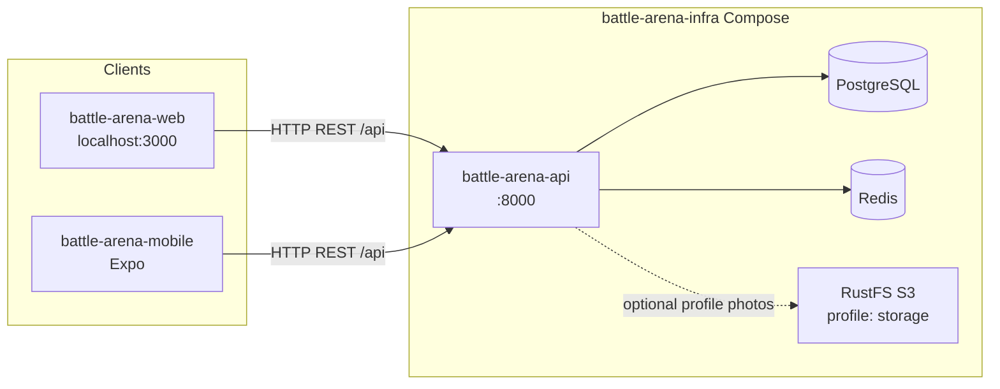

# Battle Arena Infrastructure

Central Docker Compose development environment for sibling repositories.

## Repository responsibilities

| Repository | Role |
|------------|------|
| `battle-arena-api` | Laravel 13 modular monolith REST API |
| `battle-arena-web` | React + Vite + Tailwind web client |
| `battle-arena-mobile` | Expo React Native client (runs outside Docker) |
| `battle-arena-infra` | Local Compose orchestration only |

## Architecture



Web and mobile consume the **same** API. Creature catalog data is served from PostgreSQL. PokéAPI is used only by the Artisan import command.

## Services and ports

By default published ports bind to `127.0.0.1` only.

| Service | Port | Purpose | Default bind |
|---------|------|---------|--------------|
| `web` | 3000 | Vite React app | localhost |
| `api` | 8000 | Laravel REST API | localhost |
| `postgres` | 5432 | Database | localhost |
| `redis` | 6379 | Cache / session / queue | localhost |
| `minio` (RustFS) | 9000 / 9001 | Optional S3 (`--profile storage`) | localhost |

## First-time setup

```bash
cd battle-arena-api
cp .env.example .env
# APP_KEY is generated safely on first API container start (never force-rotated)

cd ../battle-arena-web
cp .env.example .env

cd ../battle-arena-infra
cp .env.example .env
docker compose up --build -d
docker compose exec api php artisan migrate
docker compose exec api php artisan creatures:import
```

## Day-to-day commands

```bash
cd battle-arena-infra

docker compose up --build -d
docker compose down
docker compose logs -f api web postgres redis

docker compose exec api php artisan migrate
docker compose exec api php artisan creatures:import
docker compose exec api php artisan test

docker compose exec web npm run lint
docker compose exec web npm run typecheck
docker compose exec web npm test
```

## Network security and mobile LAN access

- Default: `BIND_ADDRESS=127.0.0.1` so Postgres, Redis, API, and Web are not reachable from other machines.
- Physical mobile device on the LAN:

```env
# battle-arena-infra/.env
BIND_ADDRESS=0.0.0.0
```

Then restart Compose and point the mobile app at `http://<your-LAN-IP>:8000`.

Simulators:

- Android emulator: `http://10.0.2.2:8000`
- iOS simulator: `http://localhost:8000`

## Application key policy

The API entrypoint (`battle-arena-api/scripts/docker-entrypoint.sh`):

1. Runs `composer install`
2. Generates `APP_KEY` **only** when missing
3. Never uses `key:generate --force`
4. Refuses to start if the key is still missing/invalid
5. Does not hide initialization failures with `|| true`

## Optional local S3 (RustFS)

Storage is **not** required for health checks, readiness, or the creature catalog.

```bash
docker compose --profile storage up -d minio minio-init
```

| Item | Value |
|------|--------|
| Console | [http://localhost:9001/rustfs/console/](http://localhost:9001/rustfs/console/) |
| S3 API | [http://localhost:9000](http://localhost:9000) |
| Bucket | `battle-arena-profiles` (**private**) |

### Public avatars later (without exposing unrelated files)

Keep the bucket private by default. Prefer one of:

1. Short-lived signed `GetObject` URLs for authenticated profile photo delivery
2. A dedicated public prefix such as `public-avatars/*` with a **scoped** bucket policy that grants anonymous read only under that prefix — never `bucket/*`

## ADR: Independent repositories + central Compose

We use four Git repositories so API, web, mobile, and infra remain independently deployable and versioned. A single Compose file in `battle-arena-infra` references sibling build contexts for local developer experience without creating a monorepo.
