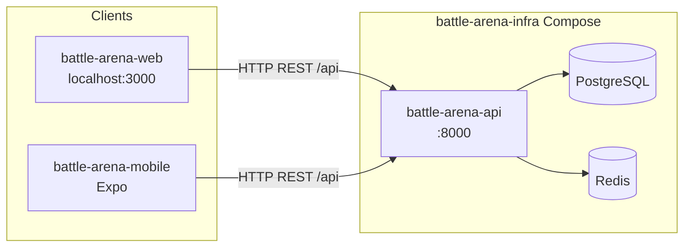

# Battle Arena Infrastructure

Central Docker Compose development environment for sibling repositories.

## Repository responsibilities

| Repository | Role |
|------------|------|
| `battle-arena-api` | Laravel 13 modular monolith REST API |
| `battle-arena-web` | React + Vite web client |
| `battle-arena-mobile` | Expo React Native client (runs outside Docker) |
| `battle-arena-infra` | Local Compose orchestration only |

## Architecture



Web and mobile consume the **same** API. Battle logic will remain server-authoritative in future phases. Phase 1 has **no WebSockets**.

## First-time setup

```bash
# From sibling checkout root
cd battle-arena-api
cp .env.example .env

cd ../battle-arena-web
cp .env.example .env

cd ../battle-arena-infra
cp .env.example .env
docker compose up --build -d
```

## Day-to-day commands

```bash
cd battle-arena-infra

# Build and start
docker compose up --build -d

# Stop
docker compose down

# Logs
docker compose logs -f api web postgres redis

# API migrations (none in Phase 1 yet)
docker compose exec api php artisan migrate

# API tests
docker compose exec api php artisan test

# Web lint / typecheck
docker compose exec web npm run lint
docker compose exec web npm run typecheck

# Mobile (host machine, not Docker)
cd ../battle-arena-mobile
npm install
npx expo start
```

## Networking

- Private Compose network: `battle_arena_net`
- Inside Docker: `DB_HOST=postgres`, `REDIS_HOST=redis`
- Browser calls API at `http://localhost:8000` (host-published port)
- Mobile:
  - Android emulator: `http://10.0.2.2:8000`
  - iOS simulator: `http://localhost:8000`
  - Physical device: `http://<LAN-IP>:8000`

## Troubleshooting

| Symptom | Fix |
|---------|-----|
| API not ready | `docker compose logs api postgres redis` |
| Web cannot reach API | Confirm `VITE_API_BASE_URL=http://localhost:8000` |
| Vendor/node_modules missing after mount | Named volumes `api_vendor` / `web_node_modules` protect dependencies |
| Port busy | Change `API_PORT` / `WEB_PORT` in `.env` |

## ADR: Independent repositories + central Compose

We use four Git repositories so API, web, mobile, and infra remain independently deployable and versioned. A single Compose file in `battle-arena-infra` references sibling build contexts for local developer experience without creating a monorepo.

We intentionally do **not** add a Node.js WebSocket service in Phase 1. Real-time multiplayer can be introduced later behind the same authoritative Laravel domain model (for example Laravel Reverb) once core REST boundaries and battle rules exist.
