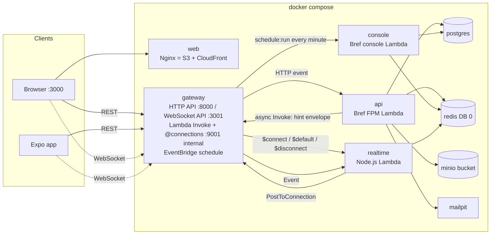

# Battle Arena Infrastructure

One local Docker Compose environment for daily development **that mirrors the proposed AWS production architecture**: Laravel runs as a Bref Lambda function behind an API Gateway emulator, realtime runs as an event-driven Node.js Lambda behind a WebSocket API emulator, and the React app is served as a static production build.

**This repository is responsible for creating the local environment: start here to run the project locally.**

This repo **only orchestrates** local containers. Application source lives in the sibling repositories. Nothing here contacts AWS, creates cloud accounts or uses paid services.

```bash
cd battle-arena-infra
docker compose up -d --build
```

Documentation:

- [`docs/AWS_MIGRATION_CHECKPOINT.md`](docs/AWS_MIGRATION_CHECKPOINT.md): migration state, test results, limitations and next steps.
- [`BATTLE_ARENA_AWS_INFRASTRUCTURE_SPEC_EN.md`](BATTLE_ARENA_AWS_INFRASTRUCTURE_SPEC_EN.md): AWS strategy (section 19a covers this environment).

## Expected folder layout

```text
C:\FREELANCE\games\
├── battle-arena-api\                 # Laravel 13 REST API (authoritative battle engine)
├── battle-arena-web\                 # React + Vite web client
├── battle-arena-mobile\              # Expo mobile client (runs outside Docker, unchanged)
├── battle-arena-realtime\            # Node.js WebSocket transport (Lambda handler in src/lambda)
└── battle-arena-infra\               # This repo — Compose only
    ├── compose.yaml
    ├── docker\                       # Dockerfiles: api (Bref), realtime (Lambda), web (Nginx), gateway
    ├── scripts\e2e-smoke.mjs         # End-to-end validation (web + Expo style clients)
    ├── docs\                         # AWS migration checkpoint
    ├── .env.example
    └── README.md
```

`compose.yaml` builds from `../battle-arena-api`, `../battle-arena-web` and `../battle-arena-realtime`; the folders must have exactly these names.

## Repository responsibilities

| Repository | Role | In Compose |
|------------|------|------------|
| `battle-arena-api` | Laravel 13 — auth, game rules, PvE, private PvP, persistence. Authoritative. | `api`, `console` (Lambda images) |
| `battle-arena-realtime` | WebSocket transport only (tickets, room grants, hint fan-out, presence) | `realtime` (Lambda image) |
| `battle-arena-web` | React + Vite + Tailwind web client | `web` (production build) |
| `battle-arena-mobile` | Expo / React Native client | No (host machine / Expo) |
| `battle-arena-infra` | Compose orchestration, Lambda packaging, local AWS edge emulator | — |

## Architecture

| Production (proposed) | Local service | Implementation |
|---|---|---|
| API Gateway HTTP API | `gateway` → host port **8000** | Local emulator (payload format 2.0) |
| API Gateway WebSocket API | `gateway` → host port **3001**, stage `/ws` | Local emulator (`$connect`/`$default`/`$disconnect`, `@connections`) |
| Lambda + Bref: Laravel HTTP | `api` | `bref/php-84:3`, PHP-FPM runtime, AWS Lambda Runtime Interface Emulator |
| Lambda + Bref: artisan + EventBridge `rate(1 minute)` | `console` + `gateway` scheduler | `bref/php-84:3`, console runtime |
| Lambda: Node.js WebSocket transport | `realtime` | `public.ecr.aws/lambda/nodejs:22`, `dist/lambda/handler.handler` |
| S3 + CloudFront | `web` → host port **3000** | `vite build` output behind Nginx (immutable assets, SPA fallback) |
| Neon PostgreSQL | `postgres` | PostgreSQL 16 |
| Upstash Redis | `redis` | Redis 7, **one logical DB (index 0)** like Upstash |
| Amazon S3 | `minio` + `minio-init` | RustFS, private bucket `battle-arena-profiles` |
| Email provider | `mailpit` | Mailpit |
| SQS / DynamoDB | — | Not needed (see below) |



- **Laravel is authoritative** for identity, rules, rooms, battles and XP. Node only transports hint-only notifications; clients rehydrate state through REST.
- **No permanently running socket process and no Redis Pub/Sub subscriber.** Laravel async-invokes the realtime function (`PVP_REALTIME_DRIVER=lambda`); the function posts frames through the `@connections` API. Connection registry, room membership and presence live in Redis.
- Clients still call `POST /api/realtime/tickets` and connect to the returned `ws_url` (`ws://localhost:3001/ws`), then send `room.subscribe` with a Laravel grant. The WebSocket protocol and REST contracts are unchanged; the Expo app needs no changes.

### Services

| Service | Port | Runs | Notes |
|---|---|---|---|
| `gateway` | 8000, 3001 (9001 internal) | always | The only entry point to the Lambda functions |
| `api` | — | always | Laravel HTTP function; not published, like a Lambda |
| `console` | — | always, idle | Target of the per-minute schedule (~55 MB RAM, 0% CPU idle) |
| `realtime` | — | always | WebSocket routes + fan-out |
| `web` | 3000 | always | Static production build |
| `postgres` | 5432 | always | Database `battle_arena` |
| `redis` | 6379 | always | Sessions, cache, tickets, grants, presence, WebSocket registry |
| `minio` | 9000 / 9001 | always | Avatars (`profiles/` prefix) |
| `minio-init` | — | exits 0 | Creates the private bucket (one-shot, like the Terraform bucket) |
| `mailpit` | 8025 / 1025 | always | UI http://localhost:8025 |

**Is a dedicated `console` container necessary?** Yes, for one reason: production schedules `schedule:run` through EventBridge to a separate Bref console function (PHP-FPM and console are different Bref runtimes and cannot share one function). Locally that keeps turn-deadline adjudication (`pvp:adjudicate-action-deadlines`) running every minute, as it would in AWS. It is idle between invocations. For *interactive* artisan use you do not need it: `docker compose exec api php artisan …` runs in the same image. Disable the schedule with `SCHEDULES=` in `.env` if you ever want to.

### Why SQS and DynamoDB are not used

- **SQS:** gameplay dispatches no queued jobs (`QUEUE_CONNECTION=sync`). Only the admin `creatures:import --all` queues jobs — run it with `--sync`. Realtime hints are best-effort by contract, so async Lambda invokes are enough.
- **DynamoDB:** Redis (Upstash in production) already holds tickets, grants and presence; the WebSocket connection registry fits there with TTLs.

## First-time setup

```bash
# 1. Clone the sibling repositories (realtime repo must be cloned into battle-arena-realtime)
git clone https://github.com/davisa0876/battle-arena-api.git battle-arena-api
git clone https://github.com/davisa0876/battle-arena-web.git battle-arena-web
git clone https://github.com/davisa0876/battle-arena-mobile.git battle-arena-mobile
git clone https://github.com/davisa0876/battle-arena-realtime-websocket.git battle-arena-realtime
git clone https://github.com/davisa0876/battle-arena-infra.git battle-arena-infra

# 2. Environment files
cp battle-arena-api/.env.example battle-arena-api/.env
cp battle-arena-infra/.env.example battle-arena-infra/.env

# 3. Build and start
cd battle-arena-infra
docker compose up -d --build

# 4. APP_KEY (first time only, if battle-arena-api/.env has an empty APP_KEY):
docker compose exec api php artisan key:generate --show
#    paste the printed value into battle-arena-api/.env as APP_KEY=..., then:
docker compose up -d api console

# 5. Database and catalog
docker compose exec api php artisan migrate
docker compose exec api php artisan creatures:import
docker compose exec api php artisan combat:seed-mvp
```

`battle-arena-api/.env` is passed to the Lambda containers as environment (`env_file`), like Lambda configuration. It is never baked into an image. Never rotate an existing `APP_KEY`; `key:generate --show` only prints a key and changes nothing.

Check:

```bash
docker compose ps                      # minio-init shows "Exited (0)" — that is expected
curl http://localhost:8000/api/ready   # {"status":"ready",...}
```

| URL | What |
|-----|------|
| http://localhost:3000 | Web app (production build) |
| http://localhost:8000/api/health, /api/ready | API through the HTTP API gateway |
| ws://localhost:3001/ws | WebSocket API (returned as `ws_url` with each ticket) |
| http://localhost:8000/telescope | Telescope (local only) |
| http://localhost:8025 | Mailpit |
| http://localhost:9001/rustfs/console/ | RustFS console |

## Daily development

```bash
docker compose up -d --build                     # start / rebuild everything
docker compose logs -f gateway api realtime      # logs (the CloudWatch stand-in)
docker compose down                              # stop (volumes kept; never use down -v)

# Laravel — artisan, tests and tools run inside the Lambda image (same PHP, extensions, vendor)
docker compose exec api php artisan migrate
docker compose exec api php artisan test
docker compose exec api php artisan test --filter=PvpBattleFlowTest
docker compose exec api php artisan openapi:sync
docker compose exec api php artisan trainer:award-xp <handle> 250 --source=dev --key=my-key
docker compose exec api vendor/bin/pint
docker compose exec api vendor/bin/phpstan analyse --memory-limit=1G

# End-to-end check of the whole stack (web cookie client + Expo bearer client)
node scripts/e2e-smoke.mjs
```

### What reloads automatically and what needs a rebuild

| Change | Effect |
|---|---|
| Laravel code, routes, config, migrations, lang, views, tests | **Live.** Source directories are bind-mounted into `/var/task`; PHP-FPM revalidates files on each request; bootstrap caches live in `/tmp`. |
| `battle-arena-api/composer.json` / `composer.lock`, `phpstan.neon.dist` | `docker compose up -d --build api console` (vendor and tool config are part of the image, as in a Lambda artifact) |
| `battle-arena-api/.env` | `docker compose up -d api console` |
| `battle-arena-realtime` code | `docker compose up -d --build realtime` (~20 s) |
| `battle-arena-web` code | `docker compose up -d --build web` (production build), **or** use Vite hot reload below |

**Web hot reload (optional):** the static `web` container is what CloudFront would serve. For HMR while editing the UI, run Vite on the host against the same API (needs Node ≥ 22.12, like the web repo):

```bash
cd battle-arena-web
npm run dev -- --port 5173      # http://localhost:5173 — already allowed by CORS, Sanctum and the WebSocket origin list
```

### Turn-timeout scenario

`PVP_TURN_TIMEOUT_SECONDS` comes from `battle-arena-api/.env` (300 s). To watch the scheduler end a turn on its own, temporarily set e.g. `45`, run `docker compose up -d api console` and `node scripts/e2e-smoke.mjs --turn-timeout`, then restore the value.

## Mobile (Expo)

The mobile app is unchanged and uses the same endpoints as before:

- iOS simulator: `EXPO_PUBLIC_API_BASE_URL=http://localhost:8000`
- Android emulator: `http://10.0.2.2:8000` and set `PUBLIC_WS_URL=ws://10.0.2.2:3001/ws` in `battle-arena-infra/.env`
- Physical phone: see the LAN section below.

## Network security and mobile LAN access

Each published port has its own bind variable; all default to `127.0.0.1`.

| Variable | Service | Default | May be `0.0.0.0`? |
|----------|---------|---------|-------------------|
| `API_BIND_ADDRESS` | `gateway` HTTP API (8000) | `127.0.0.1` | Yes, for physical mobile device testing |
| `REALTIME_BIND_ADDRESS` | `gateway` WebSocket API (3001) | `127.0.0.1` | Yes, with the API, for physical phones |
| `WEB_BIND_ADDRESS` | `web` (3000) | `127.0.0.1` | Optional (LAN browser access) |
| `POSTGRES_BIND_ADDRESS` | `postgres` | `127.0.0.1` | **No** |
| `REDIS_BIND_ADDRESS` | `redis` | `127.0.0.1` | **No** |
| `MINIO_BIND_ADDRESS` | `minio` | `127.0.0.1` | **No** (avatars are served through the API) |

Physical phone on the LAN (`battle-arena-infra/.env`):

```env
API_BIND_ADDRESS=0.0.0.0
REALTIME_BIND_ADDRESS=0.0.0.0
PUBLIC_WS_URL=ws://<your-LAN-IP>:3001/ws
```

Then `docker compose up -d`, point Expo at `http://<your-LAN-IP>:8000`, allow TCP 8000/3001 for the private network only, and revert afterwards. Never expose Postgres/Redis/RustFS. Never use plain `ws://` on the Internet.

## Data and storage

- PostgreSQL database `battle_arena`, Redis index 0 and bucket `battle-arena-profiles` are the same data the previous environment used.
- Avatars are stored in S3 (RustFS) under `profiles/avatars/…` and streamed by `GET /api/avatars/{user}`. A Lambda has no persistent disk, so the local `profiles_local` disk is no longer used by the running app. The four avatars that existed on the old `api_profiles` volume were copied into the bucket (`player_profiles.avatar_disk` switched to `profiles`); the volume itself was kept unchanged as a backup.
- Laravel's cache moved from Redis index 1 to index 0 (Upstash has a single logical database). The old index-1 keys are only cache entries.

### Data that is no longer used (kept, not deleted)

| Leftover | Origin | Remove only if you want to |
|---|---|---|
| Volumes `battle-arena-infra_api_vendor`, `_web_node_modules` | Old `php artisan serve` / Vite containers | `docker volume rm battle-arena-infra_api_vendor battle-arena-infra_web_node_modules` |
| Volume `battle-arena-infra_api_profiles` | Old local avatar disk (copied to S3) | After confirming avatars work: `docker volume rm battle-arena-infra_api_profiles` |
| Database `battle_arena_prdsim`, Redis DB 2, bucket `battle-arena-prdsim-profiles` | Interim production simulation | `docker compose exec postgres dropdb -U battle_arena battle_arena_prdsim` etc. |
| Users with emails `*@e2e.battlearena.local` | `scripts/e2e-smoke.mjs` test accounts | Delete via SQL if unwanted |
| `battle-arena-api/Dockerfile` + `scripts/docker-entrypoint.sh`, `battle-arena-web/Dockerfile`, `battle-arena-realtime/Dockerfile` | Old container definitions in the app repos | Not used by this Compose file anymore; left in their repositories |

## Remaining differences from real AWS production

**Not AWS.** The `gateway` is a local emulator (Node 22 + `ws`); AWS SAM has no WebSocket support, LocalStack's API Gateway v2 WebSocket is a paid feature and serverless-offline needs a Serverless account. Behaviour follows the public AWS documentation but is not identical.

- **Gateway:** no IAM/SigV4 verification (any credentials accepted), throttling, quotas, authorizers, stages/deployments, custom domains, TLS or WAF. HTTP API binary detection is a heuristic. WebSocket frames all route to `$default`.
- **Lambda:** the RIE does not freeze execution environments between invocations, so code that keeps working after returning would appear to work locally but not in AWS. No init-phase timeout, CPU-per-memory scaling, reserved/provisioned concurrency or real cold starts. Async retries take seconds instead of minutes; no DLQ/destinations. One container = one execution environment (`docker compose up -d --scale api=2` gives two).
- **Development conveniences that a production artifact must not have:** source is bind-mounted over `/var/task` (production: immutable package with baked route/event caches), the image includes `require-dev` (build with `--build-arg COMPOSER_DEV=0` for production), `APP_ENV=local`/`APP_DEBUG=true`, Telescope enabled, and `.env` + `.phpunit.result.cache` are mounted so tests can run.
- **WebSocket:** `DeleteConnection` closes with a generic code instead of specific ones; there are no server-side heartbeat pings (client app pings keep the 10-minute idle timeout alive and cost one Lambda invocation each); `connection.ready` arrives through an async self-invoke.
- **Neon (not validated):** TLS (`DB_SSLMODE=require`), pooled endpoints (PgBouncer transaction mode vs. PDO prepared statements), suspend/resume latency, connection limits.
- **Upstash (not validated):** TLS (`rediss://`), per-command pricing and latency, request size limits. Never run `cache:clear` there: with a single database it also deletes sessions, tickets and presence.
- **S3 / CloudFront:** RustFS implements the S3 subset used; IAM, bucket policies, Block Public Access, OAC, lifecycle rules, edge caching and invalidations are not simulated. Locally `localhost:3000` and `:8000` are same-site; a CloudFront domain plus an `execute-api` domain are **cross-site**, so cookie auth in AWS needs custom domains under one registrable domain (or `/api` routed through CloudFront), `SESSION_SECURE_COOKIE=true` and HTTPS/WSS.
- **EventBridge:** a fixed local timer; real delivery is at-least-once (the schedule uses `withoutOverlapping`).
- **Email:** Mailpit only.

### Before a real AWS deployment

| Item | Status |
|---|---|
| `bref/bref ^3.0.16` + `bref/laravel-bridge ^3.1` added to `battle-arena-api/composer.json` (today the image adds them; bridge 2.x does not support Laravel 13) | Open |
| S3 disks pass `AWS_SESSION_TOKEN` (Lambda role credentials) | Done in the API |
| Swagger spec read from the package (`base_path('storage/api-docs')`) | Done in the API |
| `telescope:prune` only scheduled when Telescope is installed | Done in the API |
| `REDIS_CACHE_DB=0` for Upstash | Done here; keep in production config |
| Pre-existing: `pvp.invitation.changed` from accept/decline/cancel carries `status`, which the realtime strict schema rejects, so those hints are dropped | Open (contract decision) |
| Pre-existing: non-UUID PvP ids return 500 on PostgreSQL | Open |

## Validation (2026-11-27)

| Check | Result |
|---|---|
| `docker compose up -d --build` | 9 long-running services + `minio-init` (exit 0); no other containers |
| `docker compose exec api php artisan test` (inside the Bref Lambda image) | **607 passed** (6 336 assertions) |
| `node scripts/e2e-smoke.mjs` | **26/27 passed, 0 failed**, 1 known pre-existing issue (invitation hint schema) |
| Realtime `lint` / `typecheck` / `vitest` / build | clean / clean / 45 passed / OK (last run this session; code unchanged since) |
| Web `vite build` (in the `web` image) | OK. Web `lint` (2 errors) and `vitest` (4 failures) are pre-existing on the untouched web `HEAD` |
| Mobile | Unchanged; `tsc --noEmit` OK |
| Laravel hot reload | A controller change was served by the next request without restart |
| Existing data | 541-creature catalog, existing users and 4 existing avatars served through the new stack |

The e2e script covers: Lambda/Bref runtime and read-only/unprivileged containers; no Redis Pub/Sub subscribers; health/readiness; web cookie session and Expo bearer registration, logout/login, 401 for guests; verification email; avatar upload to S3 and binary download; catalog and unchanged feature flags; starter, cross-user 403; PvE battle with XP; WebSocket ticket auth, reused-ticket (401) and foreign-Origin (403) rejection; presence; private room invite/decline/accept, grants, selection, ready; every battle action hinting both sockets; reconnect with new ticket + grant; forfeit; turn deadline set/cleared; logout clearing presence; CloudFront-style caching and SPA fallback of the web build.

## Troubleshooting

| Symptom | What to check |
|---------|----------------|
| `api` returns 500 right after setup | `APP_KEY` missing in `battle-arena-api/.env` (see first-time setup) |
| API change not visible | Composer change? rebuild `api console`. `.env` change? `docker compose up -d api console` |
| `/api/ready` 503 | `postgres` / `redis` unhealthy: `docker compose ps` |
| WebSocket upgrade rejected | Ticket expired (~30 s) or reused, Origin not in `WS_ALLOWED_ORIGINS`, Redis down |
| Avatars 404 | `minio` not healthy or object missing in `battle-arena-profiles/profiles/avatars/` |
| Phone cannot reach WS | `REALTIME_BIND_ADDRESS=0.0.0.0` and `PUBLIC_WS_URL=ws://<LAN-IP>:3001/ws`, then `docker compose up -d` |
| Logs | `docker compose logs -f gateway api console realtime` (RIE prints `START`/`REPORT` per invocation) |

## ADR: Independent repositories + central Compose

Five Git repositories keep API, web, mobile, realtime and infra independently deployable and versioned. This repo references sibling build contexts for local development and owns the Lambda packaging (`docker/`) without creating a monorepo.
